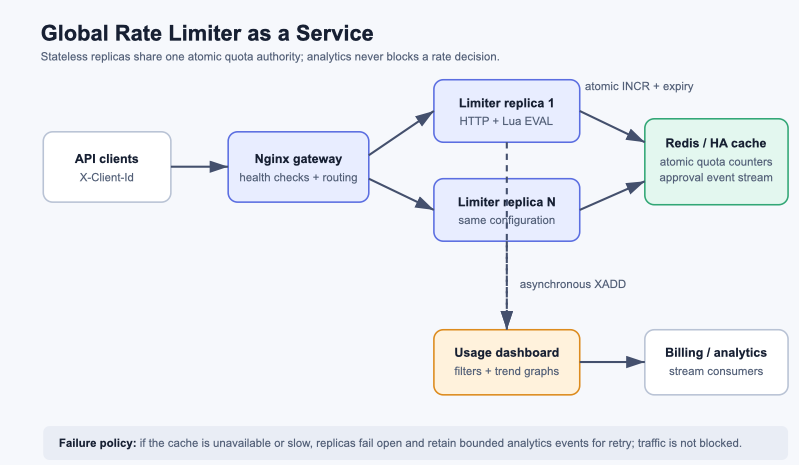

# Global Rate Limiter as a Service

A small, production-oriented solution for globally enforcing per-client limits across multiple service instances. It has no third-party Python dependencies: Python's HTTP and TCP primitives talk directly to Redis, keeping the hot path transparent and easy to review.



## What is included

- `POST /v1/limit/check`: fast quota decision for a client and external target API.
- Redis Lua script for atomic, cluster-wide fixed-window counters. The script uses **Redis server time** so replica clocks cannot skew quotas.
- Horizontally scalable, stateless app replicas behind Nginx. `docker compose up --build --scale app=3` runs three replicas with a shared limit.
- A fail-open policy: a Redis timeout or outage allows the request rather than stopping all traffic. The response includes `degraded: true` so callers can alert.
- Non-blocking approval logging to Redis Streams, with a bounded local retry queue. Analytics/billing does not sit on the rate-decision path.
- Dashboard at `/`, with client filtering, 10/15/30 day filters, average decision time, and daily/hourly/15-minute trend graphs.
- Unit, concurrent race-condition, and lightweight performance tests.
- Real-Redis integration tests that run 600 checks from six independent app
  processes, plus an outage/recovery check.
- Docker Compose starts Redis, two app replicas, and the gateway with one command.

## Run it

Prerequisites: Docker Desktop / Docker Engine with Docker Compose v2. The container image includes Python 3.13; no local Python packages are needed.

```bash
docker compose up --build
```

Open [http://localhost:8080](http://localhost:8080) for the dashboard. The public API and health check are served through the same address.

Scale the service (the gateway stays on port 8080):

```bash
docker compose up --build --scale app=3
```

Stop it with `docker compose down`; add `-v` only when you deliberately want to remove the local Redis analytics data.

## Try the API

`client-a` has a 100 requests/minute limit by default; `client-b` has 5,000. Unknown clients use the `default` limit of 60.

```bash
curl -i -X POST http://localhost:8080/v1/limit/check \
  -H 'content-type: application/json' \
  -H 'x-client-id: client-a' \
  -d '{"endpoint":"banking-transfers"}'
```

Success is `200` and contains `allowed: true`. On quota exhaustion the service returns `429`, `Retry-After`, and the remaining time in `retryAfterMs`.

```json
{
  "allowed": true,
  "clientId": "client-a",
  "limit": 100,
  "remaining": 99,
  "retryAfterMs": 44283,
  "degraded": false
}
```

Configure limits before starting the service:

```bash
CLIENT_LIMITS_JSON='{"payments":500,"shipping":1200,"default":30}' docker compose up --build
```

For production, inject this variable with your secret/configuration system and authenticate the calling gateway before it sets `X-Client-Id`.

## Test

The test suite uses Python's built-in `unittest` runner; it needs Python 3.11+ and no `pip install`.

```bash
python3 -m unittest discover -s test -v
# Or run individual required checks:
python3 -m unittest test.test_rate_limiter -v
python3 -m unittest test.test_race_condition -v
python3 -m unittest test.test_load_performance -v
```

The race test submits 500 simultaneous requests against a limit of 100 and verifies exactly 100 pass. In Redis, that same guarantee comes from the single `EVAL` script: no read/modify/write race exists between replicas. The load test reports p95 in-process decision latency; verify end-to-end capacity with your expected Redis and network topology before setting an SLO.

The integration tests require `redis-server` on `PATH`. They launch an
isolated instance, submit 600 checks for one client from six separate
processes, and assert exactly 100 approvals with no degraded decisions. They
also verify that a Redis outage is reported and that the client recovers after
Redis restarts. GitHub Actions runs the full suite with Redis installed.

## Local real-Redis benchmark

```bash
python3 -m benchmarks.redis_multiprocess --checks-per-process 1000
```

The benchmark starts a disposable Redis instance, then makes 6,000 decisions
for one client from six Python processes with 20 threads each. Two runs on an
arm64 Mac (Python 3.11.15, local Redis, no AOF) admitted exactly 100 requests,
with no degraded decisions, and measured 12.0k–15.5k checks/s including
process startup. Client-side p50 was 2.0–2.6 ms; p95 was 7.5–16.7 ms and p99
was 10.7–121.9 ms, showing substantial tail variation. These are local
synthetic measurements, not a production SLO or a guarantee during Redis
outage. Set a service target only after testing the deployed topology.

## Architecture and design decisions

The rendered submission diagram is [`docs/architecture.png`](docs/architecture.png); the editable source is [`docs/architecture.svg`](docs/architecture.svg).

1. **Global correctness.** Every replica executes one Redis Lua command which uses `INCR` plus `PEXPIRE` atomically. All app instances therefore see the same counter. The hash tag in the counter key pins a client's key to one Redis Cluster slot.
2. **Latency.** The critical request path contains a single local-network Redis round trip. Approval-event writes are queued and flushed outside it. Configure `REDIS_TIMEOUT_MS` (default: 40 ms) to bound cache latency.
3. **Availability.** If Redis is slow or unavailable, the service returns an allowed but marked-degraded response. This intentionally favors traffic availability; metric/alert on degraded responses and use Redis Sentinel, Redis Cluster, or a managed multi-AZ Redis offering in production.
4. **Analytics.** Each approval is appended to the `rate-limiter:approvals` Redis Stream with client, target API, timestamp, and decision time. The dashboard queries the most recent 10,000 stream entries. A production billing consumer should persist stream entries to durable analytical storage (for example, ClickHouse or a warehouse) and use Redis Streams consumer groups.
5. **Algorithm.** The implementation is a fixed window, which matches the requested per-minute quotas and makes the atomic operation small. Its known edge case is a boundary burst (a client can use the end of one minute and start of the next). If a stricter smoothing policy is needed, replace the script with a Redis Lua token bucket while retaining the same service interface.

## Edge cases to verify

- Invalid/missing client IDs return `400`; only letters, digits, `.`, `_`, and `-` up to 128 characters are accepted.
- The `(limit + 1)`th request in a minute returns `429` and includes `Retry-After`.
- A new minute gives the client a fresh quota; Redis automatically expires old counters.
- Start the gateway with 3 replicas and send requests concurrently: all replicas share the same client quota.
- Temporarily stop Redis (`docker compose stop redis`): checks return `200` with `degraded: true`; they do not block traffic. Start Redis again and dashboard logging resumes.
- Stop all containers with `docker compose down` and start them again: the named volume keeps local Redis data. Use `docker compose down -v` only to erase it.

## Production checklist

- Place this service behind authenticated TLS termination; never let arbitrary public callers choose another client's ID.
- Use an HA Redis deployment with persistence and alert on latency, disconnections, fail-open decisions, and analytics queue pressure.
- Move long-term events out of the bounded Redis Stream into a durable analytics store; protect the dashboard with normal application authorization.
- Set per-client limits from an authoritative config/control plane and deploy the same configuration to every replica.
